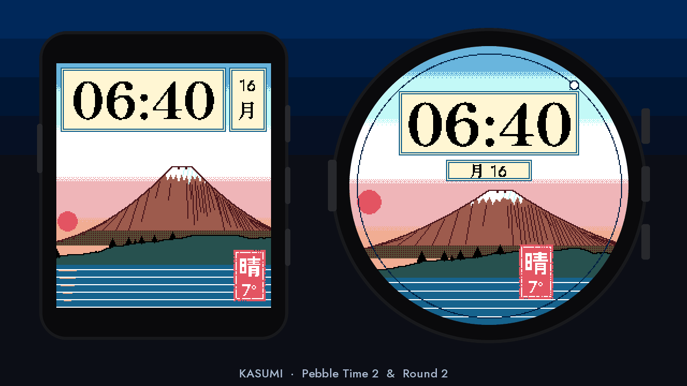
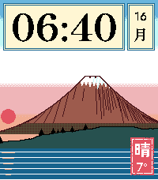
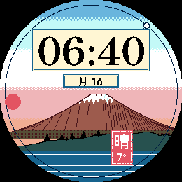
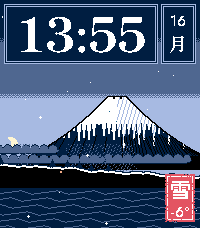
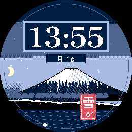

# Kasumi

A weather watchface for Pebble Time 2 and Pebble Round 2, painted after Hokusai's *Thirty-six
Views of Mount Fuji*. One mountain stays; the weather and the time of day repaint everything
around it.



**Get it:** [Pebble app store](https://apps.rePebble.com/263a3c2f3d1f4dd49305a365)

- Watchface for Pebble Time 2 (`emery`, 200×228) and Pebble Round 2 (`gabbro`, 260×260).
- Weather comes from the Pebble app's **weather plugin** (Pebble app 1.18 or later, plugins preview
  turned on under Settings → Plugins → Plugins / permissions preview).
- Written in C. It paints every pixel itself.

| Time 2 | Round 2 |
|---|---|
|  |  |
|  |  |

## What changes what

- **Condition:** clear is Prussian blue; partly cloudy gives a mackerel sky; overcast puts banks of
  cloud across the slopes; a storm turns Fuji black with red lightning at its foot (after
  *Thunderstorm Beneath the Summit*).
- **Temperature:** the snowline drops as it gets colder; on a clear dawn, dusk or a day of 22 °C or
  more the mountain turns red (after *Fine Wind, Clear Morning*). The red seal shows the
  temperature and the weather as one kanji (晴 曇 雨 雪 霙 嵐 風).
- **Sunrise and sunset:** five skies (night, blue hour, dawn, day, dusk); the sun crosses the sky
  and reddens when low; the moon shows its real phase. Rib lines on the mountain are denser on the
  side away from the light.
- **Wind:** the water goes from calm lines to waves with curling foam; rain slants; clouds trail.
  On the Round 2 a bead on the rim shows where the wind comes from.
- **Precipitation:** rain strokes, snowflakes, rings on the water.
- **Humidity:** bands of mist at the foot of the mountain.
- **UV index:** rings around the sun.
- **Next 12 hours:** the hourly temperatures shape the hills in front; distant rain curtains
  hang over the plain in the hours it will rain.
- **5-day forecast (optional):** five small prints, or five seals.
- **No weather yet** (plugins preview off): the sky still follows the clock with default sun times, and for
  the first two days a note explains how to turn the preview on. A shake hides it; it goes away by itself
  when the first weather arrives.
- **Stale data:** after an hour without updates the colour drains to grey.

A short animation (rain, snow, water, lightning) plays when you glance at the watch, shake your
wrist, or the backlight comes on (setting).

## Building

You need the Pebble SDK 4.44 or later and `pebble-tool` 5.1 or later
([developer.repebble.com](https://developer.repebble.com)).

```sh
pebble build
pebble install --emulator emery     # or gabbro
pebble logs --emulator emery
```

The emulator's weather plugin sample has no sunrise, wind, humidity or hourly/daily series, so
parts of the picture fall back to quiet defaults there. Use the demo builds below to see every
scene.

## How it works

```
Pebble app weather plugin ──► src/pkjs/index.js ──AppMessage──► src/c/main.c ──► src/c/render.c
     (weather/location)        (phone, PKJS)                     (state, timers)    (frame buffer)
                                     ▲
                    config.html ─────┘ (bundled settings page, live messages)
```

- **`src/pkjs/index.js`** subscribes to the `weather/location` source with
  `Pebble.subscribeToSource`, only for the properties the enabled layers need, for the place
  chosen in the settings (merged with the order from `preferences/weather_location`). It
  converts units, finds "now" in the hourly and daily series from `start` + `stepSec`, and sends
  one AppMessage. Missing properties are not sent; the watch falls back to defaults and never
  draws a forecast it wasn't given.
- **Permissions:** `Location` only, no `Internet`, so the location can't leave the phone
  (manifest version 2, `usesPermissions`).
- **`config.html`** is bundled in the pbw (`configPage` in `package.json`) and talks to PKJS while
  it's open (`Pebble.sendMessage` ↔ `configmessage`), so the preview button updates the watch
  live. It loads nothing from the network.
- **`src/c/render.c`** paints the whole scene straight into the frame buffer
  (`graphics_capture_frame_buffer` + `gbitmap_get_data_row_info`) in the 64-colour palette, with
  4×4 Bayer dithering for the bokashi seams. Apps build for a Cortex-M3 without an FPU, so the
  per-pixel work is integer only. Text sits on a marker-colour mask instead of many halo draws.
  A full frame takes roughly 60–80 ms on a Time 2.
- **`src/c/main.c`** keeps the last weather and settings in persistent storage, redraws on the
  minute, and runs the ~1.8 s animation (2.6 s with lightning) at about 15 fps when the chosen
  trigger fires: `accel_tap_service` (shake), `accel_data_service` at 10 Hz with a face-up
  heuristic (glance), or `backlight_service`.

### Why C and not Alloy

Kasumi writes every pixel and redraws the whole scene per animation frame. That needs direct
frame-buffer access and tight integer loops, which Alloy's drawing API doesn't expose. It uses
no bitmaps at all; everything is drawn from code.

## Development builds

Environment variables picked up by `wscript` (never set them for a release; run `pebble clean`
afterwards):

| Variable | Effect |
|---|---|
| `KASUMI_DEMO=1..9` | Fixed scene, ignores incoming weather: Kyoto morning, Prague rain, Tromsø snow, Tokyo noon, Kyoto dusk, storm, clear night, dawn, windy day (`src/c/demo.h`) |
| `KASUMI_DEMO_ANIM=0.17` | Freeze the animation at that point (0.17 is a lightning flash) |
| `KASUMI_DEMO_JOST=1` | Force Jost digits |
| `KASUMI_DEMO_SEALS=1` | Force the five-seals forecast |
| `KASUMI_NO_WEATHER=1` | Ignore weather messages, as if the plugins preview were off (shows the first-run hint) |
| `KASUMI_REEL=1` | Step through 30 scenes on every tap (used for the store images) |

```sh
KASUMI_DEMO=6 KASUMI_DEMO_ANIM=0.17 pebble build && pebble install --emulator gabbro
```

`tools/make-store-assets.py` builds the store screenshots, icons, banners and the animated GIF
from frames captured with a `KASUMI_REEL=1` build (`pebble screenshot` + `pebble emu-tap`).

## Fonts

Subsets of three SIL Open Font License fonts, licences next to them in `resources/fonts/`:
Shippori Mincho B1 ExtraBold (digits, weekday kanji), Jost Medium (digits, Latin date, small
labels), Zen Kaku Gothic New Bold (seal kanji).

## Licence

Code: MIT, see [LICENSE](LICENSE). Fonts: SIL OFL 1.1. Hokusai's prints, which inspired the
design, are in the public domain; no images from them are included.

It's a hobby project. If you enjoy it and feel like buying me a coffee:
https://ko-fi.com/U1O02AUNZB
